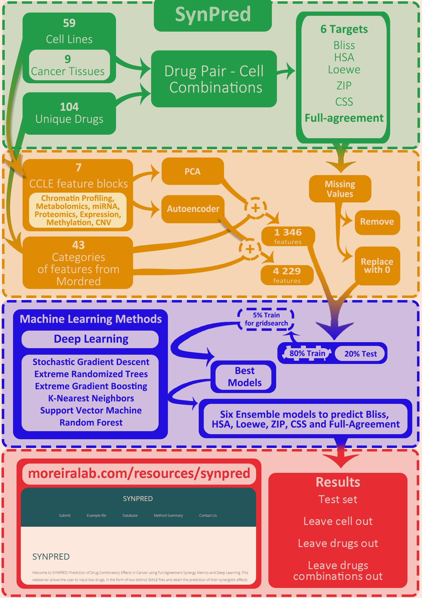

# SYNpred

**Prediction of anticancer drug combination effects using multiple synergy metrics and ensemble learning.**

SYNpred combines drug molecular descriptors with cell-line molecular features to predict
combination effects across six outputs: **Full-agreement, Bliss, ZIP, HSA, Loewe and CSS**.
The released inference workflow uses 36 machine-learning estimators, 24 individual
deep-learning models and 6 ensemble models.

<p align="center">
  
</p>

## Quick start

Clone the repository:

```bash
git clone https://github.com/MoreiraLAB/synpred.git
cd synpred
```

Create the validated environment:

```bash
bash scripts/create_standalone_env.sh
conda activate "$HOME/.conda/envs/synpred-standalone"
```

Download the released pretrained models from the
[MoreiraLAB SYNpred resource page](https://www.moreiralab.com/resources/synpred/)
and arrange them as:

```text
standalone_models/
├── ML_models/    # 36 .pkl estimators
└── DL_models/    # 24 individual + 6 ensemble .h5 models
```

Run the included example:

```bash
export SYNPRED_MODEL_DIR="$PWD/standalone_models"
python standalone_deploy_model.py standalone_example.csv
```

Predictions are written to:

```text
standalone_results/standalone_example_prediction.csv
```

## Input data

Input must be a comma-separated CSV with these columns:

```text
Cell,Drug1,Drug2
```

- `Cell`: cell-line identifier represented in the bundled mapping and PCA feature tables.
- `Drug1`, `Drug2`: SMILES strings for the two compounds.

See [`standalone_example.csv`](standalone_example.csv) for a valid input example.

## Output

The prediction table contains the original input and:

- `Full-agreement`
- `Bliss`
- `ZIP`
- `HSA`
- `Loewe`
- `CSS`
- `Synergy Votes`

`Synergy Votes` is the number of SYNpred outputs classified as synergistic according to
the thresholds implemented in the released model.

## Installation

The validated standalone environment uses:

| Package | Version |
|---|---:|
| Python | 3.8.2 |
| NumPy | 1.20.3 |
| SciPy | 1.6.3 |
| Pandas | 1.2.5 |
| scikit-learn | 0.24.2 |
| TensorFlow | 2.3.1 |
| h5py | 2.10.0 |
| XGBoost | 1.4.2 |
| RDKit | 2021.09.3 |
| Mordred | 1.2.0 |

The complete pinned dependency list is available in
[`requirements-standalone.txt`](requirements-standalone.txt). A custom Conda
environment location can be passed to the setup script:

```bash
bash scripts/create_standalone_env.sh /path/to/environment
```

## Models

The pretrained model files are distributed separately because they are too large for GitHub.
By default, SYNpred reads models from `standalone_models`. An alternative location can be
configured with:

```bash
export SYNPRED_MODEL_DIR=/absolute/path/to/standalone_models
```

The expected bundle contains:

- 36 machine-learning estimators in `ML_models/`;
- 24 individual neural-network models in `DL_models/`;
- 6 final ensemble models in `DL_models/`.

## Tests

Run the standalone tests with:

```bash
export SYNPRED_MODEL_DIR="$PWD/standalone_models"
python -m unittest -v tests.test_standalone
```

The tests validate:

- generation of a complete `1 x 1347` feature matrix;
- absence of non-finite feature values;
- presence of all released model files;
- structure and numerical validity of an end-to-end prediction output.

Additional details are provided in [`docs/STANDALONE.md`](docs/STANDALONE.md).

## Training pipeline

The repository also contains the original data-processing, training, grid-search and
evaluation scripts used to build SYNpred. Re-running model development requires external
DrugComb and CCLE data in addition to the files distributed in this repository.

The principal stages are:

1. process DrugComb combinations and molecular features;
2. prepare and reduce CCLE molecular features;
3. generate training and evaluation splits;
4. train classical machine-learning and neural-network models;
5. build the final metric-specific ensembles.

The standalone inference workflow above does not require retraining.

## Repository structure

```text
standalone_deploy_model.py        Standalone inference entry point
standalone_feature_extraction.py  Drug and cell-line feature generation
standalone_variables.py           Portable model and data configuration
standalone_example.csv            Example input
resources/                         Bundled mappings and feature resources
scripts/create_standalone_env.sh  Reproducible environment setup
tests/                             Standalone validation tests
docs/STANDALONE.md                 Detailed standalone documentation
```

## Citation

If you use SYNpred, please cite:

> António J. Preto, Pedro Matos-Filipe, Joana Mourão, and Irina S. Moreira.
> **SYNpred: Prediction of Drug Combination Effects in Cancer using Different
> Synergy Metrics and Ensemble Learning.**
> *GigaScience* 11 (2022): giac087.
> https://doi.org/10.1093/gigascience/giac087

## Versioning

`main` is the canonical maintained branch. For reproducible analyses, record the
commit SHA or release tag used.

## License

SYNpred is distributed under the
[GNU General Public License v3.0](LICENSE).
